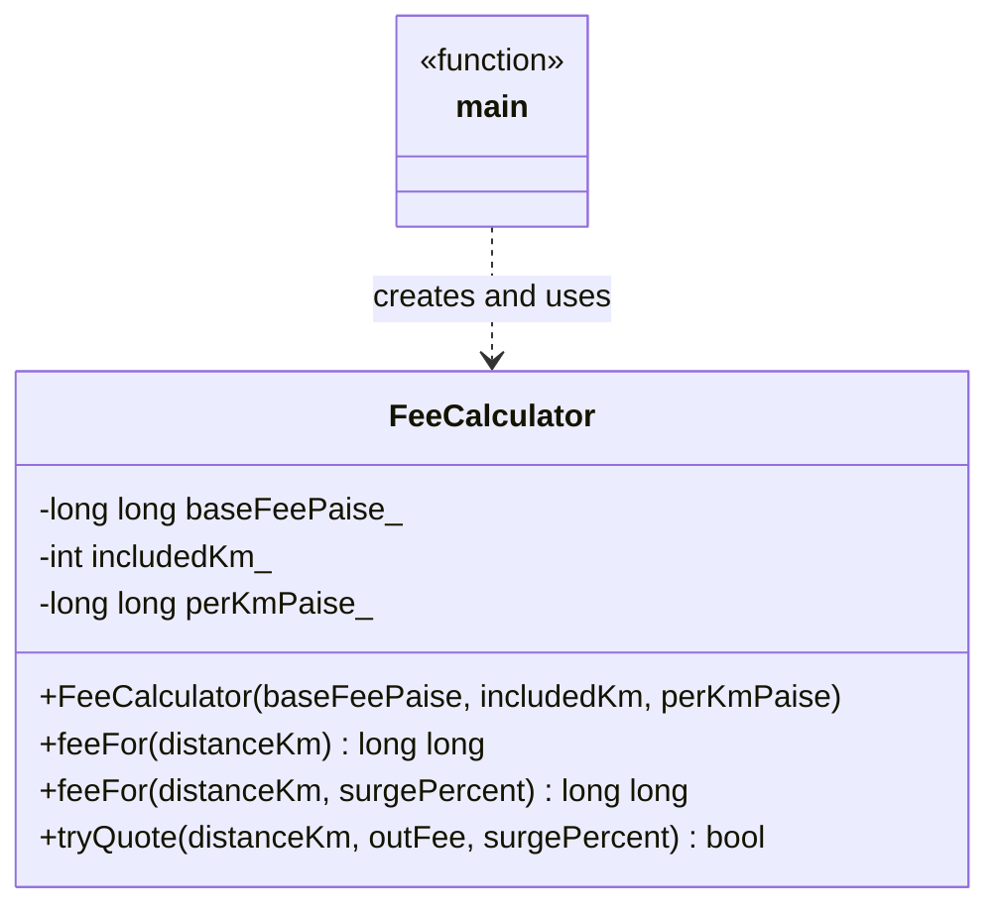
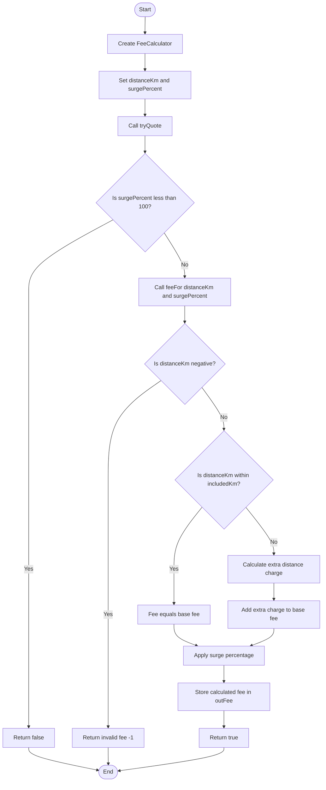
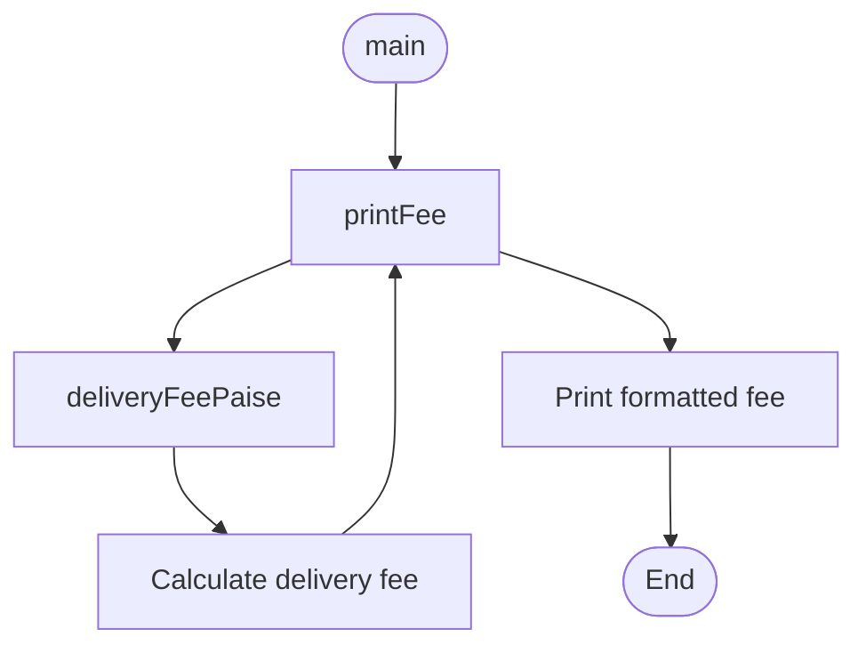

# Day 2 · Session 1 — Diagrams

## 1. Class Diagram — Code 2 (`FeeCalculator`)

### Explanation

- `-` represents private members.
- `+` represents public members.
- `feeFor()` is overloaded because two methods share the same name but accept different parameters.
- The dashed arrow represents a dependency: `main` uses `FeeCalculator` but does not inherit from it.

---

## 2. Flowchart — Code 2 (`tryQuote`)

### Explanation

1. `main` creates a `FeeCalculator` object.
2. `main` calls `tryQuote()` with the distance, output variable, and surge percentage.
3. If the surge percentage is below 100, the quote fails.
4. Otherwise, `tryQuote()` calls the overloaded `feeFor()` method.
5. A negative distance produces an invalid fee.
6. If the distance is within the included kilometres, the base fee applies.
7. Otherwise, an additional distance charge is calculated.
8. The surge percentage is applied, the result is stored in `outFee`, and the function returns `true`.

> Note: Verify these branches against your actual C++ implementation before treating this as an exact flowchart.

---

## 3. Call Graph — Code 1

### Explanation

- `main()` calls `printFee()`.
- `printFee()` calls `deliveryFeePaise()`.
- The calculated fee is then formatted and printed.

---

## 4. Relationships

| Relationship | Used? | Explanation |
|---|---|---|
| Dependency | Yes | `main` uses `FeeCalculator`. |
| Inheritance | No | No class derives from another class. |
| Composition | No | No owned part-object is shown in this example. |
| Aggregation | No | No whole–part relationship is shown. |
| Association | No explicit association | No persistent object-to-object relationship is represented. |

**Learning note:** Composition will be introduced in Session 2.