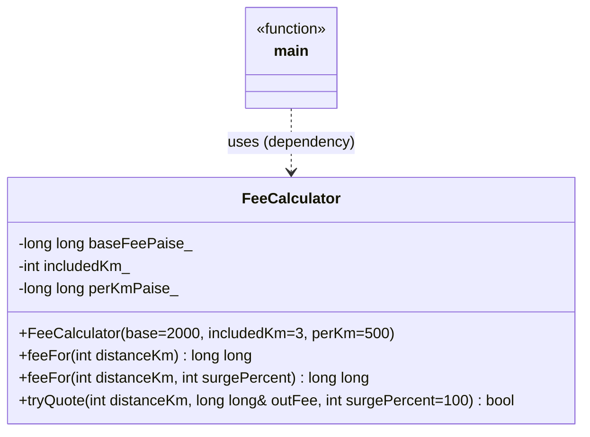

# Day 2 · Session 1 — Diagrams

## Class diagram (Code 2) — Mermaid

## Class diagram — ASCII
┌─────────────────────────────────────────────────────┐
│                  FeeCalculator                      │
├─────────────────────────────────────────────────────┤
│ - baseFeePaise_ : long long                         │
│ - includedKm_   : int                               │
│ - perKmPaise_   : long long                         │
├─────────────────────────────────────────────────────┤
│ + FeeCalculator(base=2000, km=3, perKm=500)         │
│ + feeFor(km) const : long long                      │
│ + feeFor(km, surge) const : long long   (overload)  │
│ + tryQuote(km, &out, surge=100) const : bool        │
└─────────────────────────────────────────────────────┘
          ▲  main uses it (dependency)

## Flow diagram
main → tryQuote(km, fee, surge)
         ↓
       feeFor(km, surge) → feeFor(km)
         ↓                    ↓
     surge < 100 or -1?    km < 0 → -1 | km ≤ included → base | else base + extra
         ↓ yes                ↓ ok
     return false         outFee = fee; return true

## Relationships
- Dependency: main → FeeCalculator (main only uses it while it runs).
- Inheritance / composition / aggregation / association: not used yet.
  (Composition appears in Session 2.)
- Code 1 call graph: main → printFee → deliveryFeePaise.