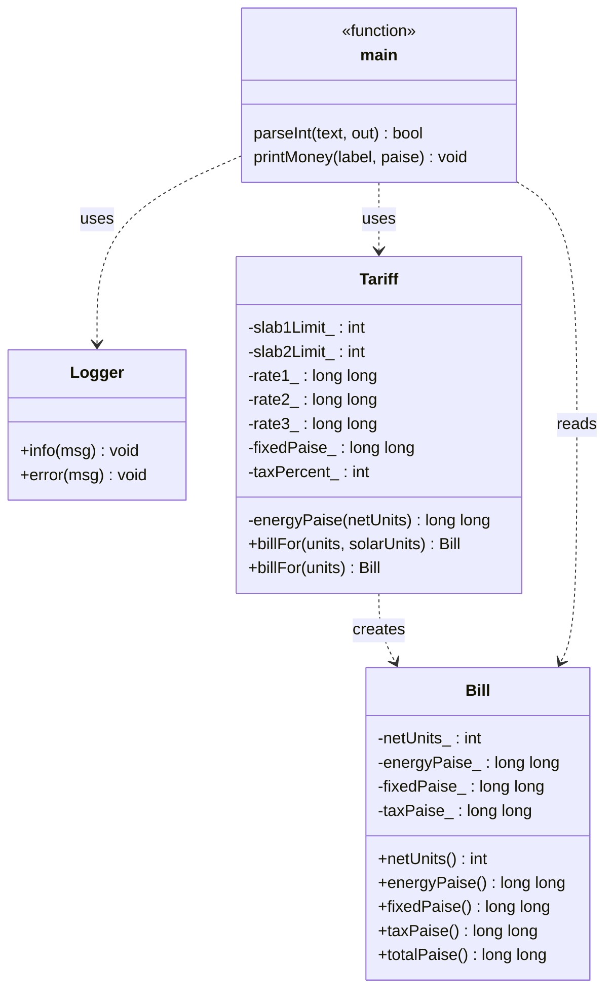

# Code 4 — Electricity Billing CLI

## 1. Class Diagram (Mermaid)



## 2. Class Diagram (ASCII)

```text
┌──────────────────────────────┐        ┌───────────────────────────┐
│           Logger             │        │           Bill            │
├──────────────────────────────┤        ├───────────────────────────┤
│ + info(msg) const            │        │ - netUnits_ : int         │
│ + error(msg) const           │        │ - energyPaise_ : ll       │
└──────────────▲───────────────┘        │ - fixedPaise_ : ll        │
               │ uses                   │ - taxPaise_ : ll          │
               │                        ├───────────────────────────┤
┌──────────────┴───────────────┐        │ + netUnits() const        │
│          main                │ reads  │ + energyPaise() const     │
│   (+ parseInt, printMoney)    │───────►│ + fixedPaise() const      │
└──────────────┬───────────────┘        │ + taxPaise() const        │
               │ uses                   │ + totalPaise() const      │
               ▼                        └─────────────▲─────────────┘
┌──────────────────────────────┐                      │ creates
│            Tariff            │──────────────────────┘
├──────────────────────────────┤
│ - slab1Limit_, slab2Limit_   │
│ - rate1_, rate2_, rate3_     │
│ - fixedPaise_ : ll           │
│ - taxPercent_ : int          │
├──────────────────────────────┤
│ - energyPaise(net) const     │
│ + billFor(units, solar)const │
│ + billFor(units) const       │
│   (overload; delegates)      │
└──────────────────────────────┘
```

## 3. Program Flow Diagram

```mermaid
flowchart TD
    A([Start]) --> B[Read argc and argv]
    B --> C{argc < 2 or argc > 3?}

    C -- Yes --> D[Print usage to stderr]
    D --> E([Exit code 2])

    C -- No --> F[Parse argv[1] as units]
    F --> G{Valid integer in range 0..100000?}

    G -- No --> H[Logger.error to stderr]
    H --> I([Exit code 3])

    G -- Yes --> J{argc == 3?}
    J -- Yes --> K[Parse argv[2] as solar units]
    K --> L{Valid integer in range 0..100000?}
    L -- No --> H
    L -- Yes --> M[Call Tariff.billFor]
    J -- No --> M

    M --> N[Calculate net units]
    N --> O[net = max(0, units - solar)]
    O --> P[Calculate energy charges]
    P --> Q[Apply slab 1, slab 2 and slab 3 rates]
    Q --> R[Calculate fixed charge]
    R --> S[Calculate tax on energy + fixed charge]
    S --> T[Build Bill object]
    T --> U[Print bill amounts]
    U --> V([Exit code 0])
```

## 4. Billing Calculation Flow

```mermaid
flowchart TD
    A([Start billing]) --> B[Receive units and optional solar units]
    B --> C[Calculate net units]
    C --> D[net = max(0, units - solar)]
    D --> E[Calculate slab 1 charge]
    E --> F[Calculate slab 2 charge]
    F --> G[Calculate slab 3 charge]
    G --> H[Sum energy charges]
    H --> I[Add fixed charge]
    I --> J[Calculate tax]
    J --> K["tax = (energy + fixed) * taxPercent / 100"]
    K --> L[Create Bill with calculated values]
    L --> M[Calculate totalPaise]
    M --> N["total = energy + fixed + tax"]
    N --> O([Return Bill])
```

## 5. Key Design Concepts

- **Encapsulation:** `Tariff` keeps tariff configuration and billing calculations private.
- **Abstraction:** `Bill` exposes getter methods to access calculated billing values.
- **Function overloading:** `billFor(units)` delegates to `billFor(units, solarUnits)` using the default solar-unit value.
- **Separation of concerns:** `Logger` handles error messages, `Tariff` calculates charges, and `main` handles input and output.
- **Input validation:** `parseInt` validates command-line input before billing begins.
- **Solar adjustment:** Net units cannot be negative because the calculation uses `max(0, units - solar)`.
- **Currency precision:** Monetary amounts are stored in paise to avoid floating-point rounding errors.
- **Tax calculation:** Tax is calculated on the sum of energy charges and fixed charges.

## 6. Command-Line Usage

```bash
# Bill for 150 units without solar adjustment
./electricity 150

# Bill for 150 units with 20 solar units
./electricity 150 20
```

Compile using C++23:

```bash
g++ -std=c++23 -Wall -Wextra -Wpedantic -o electricity code4.cpp
```

Run on Windows PowerShell:

```powershell
.\electricity.exe 150
.\electricity.exe 150 20
```

## 7. Error Handling

| Condition | Behavior | Exit code |
|---|---|---:|
| Missing units argument | Print usage message to stderr | 2 |
| Too many arguments | Print usage message to stderr | 2 |
| Invalid units input | Log error to stderr | 3 |
| Invalid solar units input | Log error to stderr | 3 |
| Valid input | Calculate and print the bill | 0 |

---

**File:** `diagrams-code-4.md`  
**Project:** C++ Learning — Electricity Billing CLI  
**Language:** C++23  
**Documentation:** Mermaid diagrams, ASCII class diagram, program flow, billing logic, and design concepts.
