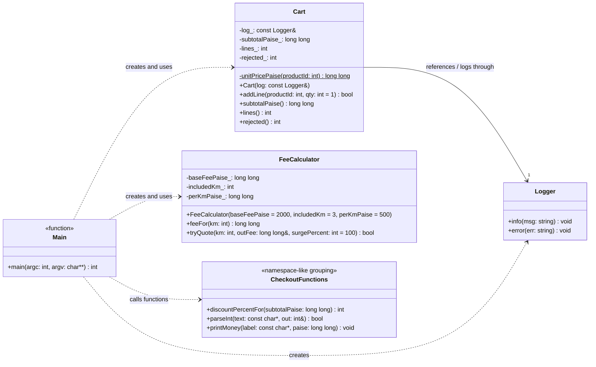
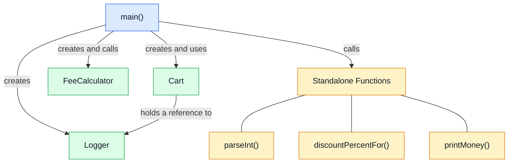
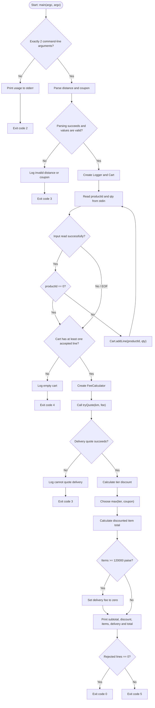
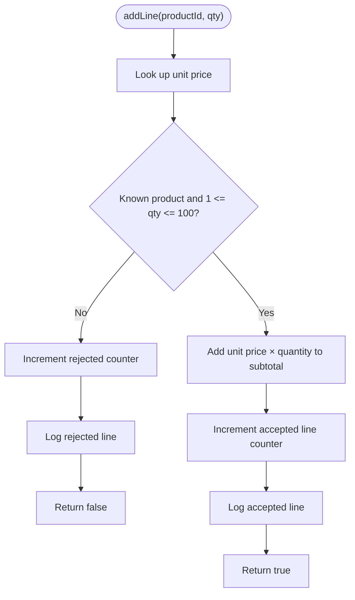
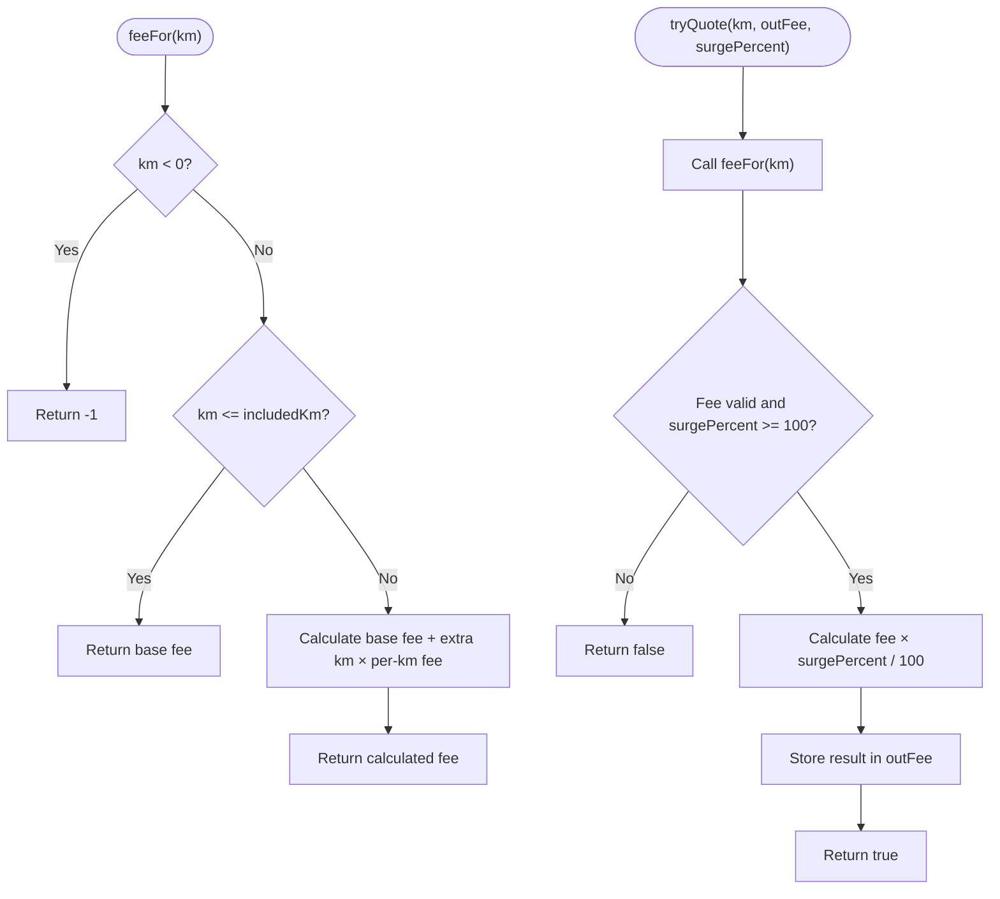

# Code 3 — Order Checkout

## 1. Class Diagram (Mermaid)

**Relationship notes**

- `Cart --> Logger`: `Cart` stores a reference to a `Logger`; it does not own the logger.
- `Main ..> Cart`: `main()` creates a cart and adds product lines.
- `Main ..> FeeCalculator`: `main()` requests a delivery quote.
- `Main ..> CheckoutFunctions`: `main()` calls the standalone parsing, discount, and money-formatting functions.
- There is no inheritance relationship in this implementation.

> `CheckoutFunctions` and `Main` are diagram-only groupings to make the relationships readable. They are not actual C++ classes. The three utility functions are standalone functions, and `main()` is a free function.

## 2. Class Relationship Diagram

## 3. Checkout Execution Flow

## 4. Cart Line Validation Flow

## 5. Delivery Fee Calculation Flow

## 6. Important Business Rules

| Rule | Implementation |
|---|---|
| Valid products | IDs `1`, `2`, and `3` |
| Valid quantity | `1` to `100` |
| Base delivery fee | ₹20 for up to and including 3 km |
| Additional distance | ₹5 per kilometre beyond 3 km |
| Coupon limit | `0%` to `50%` |
| Discount selection | Higher of tier discount or coupon; no stacking |
| Tier discounts | 5% at ₹500 or more; 10% at ₹1,000 or more |
| Free delivery | Discounted item total of at least ₹1,200 |
| Rejected lines | Logged and counted; program eventually returns exit code `5` if any were rejected |
| Currency | Stored as integer paise |

## 7. Important Implementation Notes

- `Logger`, `Cart`, and `FeeCalculator` are actual C++ classes.
- `discountPercentFor()`, `parseInt()`, and `printMoney()` are standalone functions.
- `main()` controls the checkout process and handles the exit codes.
- `Cart` keeps a reference to `Logger`; the logger must remain alive for as long as the cart uses it.
- `tryQuote()` supports a surge percentage, but `main()` uses its default of `100%`.
- The input loop ends when the product ID is `0`, input reaches EOF, or extraction fails.
